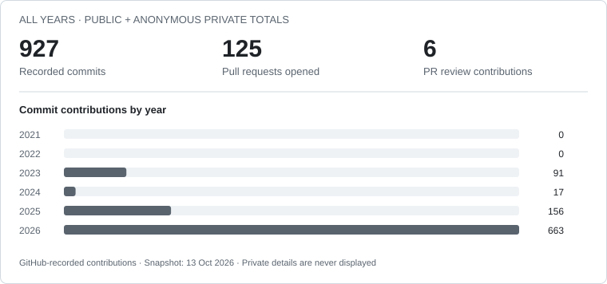

  <picture>
    <source media="(prefers-color-scheme: dark)" srcset="assets/header-dark.svg">
    <source media="(prefers-color-scheme: light)" srcset="assets/header-light.svg">
    
  </picture>

I'm a backend developer based in Viana do Castelo, Portugal, focused on **Elixir, Phoenix, and LiveView**. I build real-time applications, automated data pipelines, and self-hosted services, with experience delivering both independent projects and freelance work.

<table>
  <tr>
    <td><strong>Languages &amp; backend</strong></td>
    <td>
      
      
      
      
    </td>
  </tr>
  <tr>
    <td><strong>Data &amp; infrastructure</strong></td>
    <td>
      
      
      
      
    </td>
  </tr>
</table>

## What I build

- **Real-time applications** with Phoenix LiveView, WebSockets, and PostgreSQL.
- **Automated data pipelines** that keep application data current through web scraping and API integrations.
- **Self-hosted services** running in production on a Raspberry Pi 5 with Docker and Cloudflare Tunnel.

## Selected projects

### EFT-Buddy

A companion application for **Escape from Tarkov**, built with Elixir, Phoenix LiveView, and PostgreSQL.

- Built and launched the application with an entire data catalogue maintained through automated web scraping and GraphQL/REST integrations, with no manual data entry.
- Host it in production on a Raspberry Pi 5 using rootless Docker and Cloudflare Tunnel, with no inbound ports. Development is supported by ExUnit tests, GitHub Actions CI, and Sobelow security scanning.

**[Live application](https://eftbuddy.app/) · [Source code](https://github.com/joaoaraujo1511/EFTBuddy)**

### Steam Bot Network

A **Node.js and Express service** for managing multiple Steam trading bots through an API-key-protected REST API.

- Implemented concurrent account operation with automated two-factor authentication, trade offers, and inventory lookups.
- Implemented least-busy load balancing for trades across bots, with coordination designed for up to approximately 500 bots.

**[Source code](https://github.com/joaoaraujo1511/local-steam-bot-network)**

## Freelance experience

**Savell · Freelance Elixir Developer · September 2026**

Built an internal admin console for a pre-launch startup using Elixir and Phoenix LiveView, providing a central interface for the founders to manage and monitor the business. Combined internal application metrics with PostHog product analytics to monitor the application and inform business decisions.

## Activity

<picture>
  <source media="(prefers-color-scheme: dark)" srcset="assets/activity-dark.svg">
  <source media="(prefers-color-scheme: light)" srcset="assets/activity-light.svg">
  
</picture>

Counts follow [GitHub's contribution rules](https://docs.github.com/en/account-and-profile/reference/profile-contributions-reference). This is a dated snapshot, including anonymous private activity.

## Contact

<table>
  <tr>
    <th align="left">Email</th>
    <th align="left">LinkedIn</th>
    <th align="left">Live application</th>
  </tr>
  <tr>
    <td></td>
    <td><a href="https://www.linkedin.com/in/jo%C3%A3o-ara%C3%BAjo-840281366">João Araújo</a></td>
    <td></td>
  </tr>
</table>
