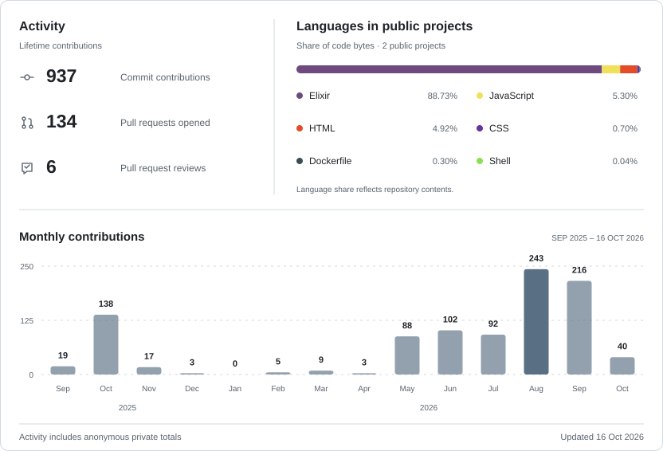

  <picture>
    <source media="(prefers-color-scheme: dark)" srcset="https://readme-typing-svg.demolab.com?font=JetBrains+Mono&amp;weight=600&amp;size=30&amp;duration=2800&amp;pause=900&amp;color=F0F6FC&amp;center=true&amp;vCenter=true&amp;width=620&amp;height=60&amp;lines=Hey%2C+I%27m+Jo%C3%A3o+Ara%C3%BAjo%3BBackend+developer%3BElixir%2C+Phoenix+%26+LiveView">
    <source media="(prefers-color-scheme: light)" srcset="https://readme-typing-svg.demolab.com?font=JetBrains+Mono&amp;weight=600&amp;size=30&amp;duration=2800&amp;pause=900&amp;color=24292F&amp;center=true&amp;vCenter=true&amp;width=620&amp;height=60&amp;lines=Hey%2C+I%27m+Jo%C3%A3o+Ara%C3%BAjo%3BBackend+developer%3BElixir%2C+Phoenix+%26+LiveView">
    
  </picture>

I'm a backend developer based in Viana do Castelo, Portugal, focused on **Elixir, Phoenix, and LiveView**. I build real-time applications, automated data pipelines, and self-hosted services.

  
  
  
  
  
  
  
  

## Featured work

| Project | Overview | Links |
| :--- | :--- | :--- |
| **EFT-Buddy** | A companion app for Escape from Tarkov. | [Live app](https://eftbuddy.app/) · [Source](https://github.com/joaoaraujo1511/EFTBuddy) |
| **Steam Bot Network** | A service for managing Steam trading bots. | [Source](https://github.com/joaoaraujo1511/local-steam-bot-network) |

## Activity

<picture>
  <source media="(prefers-color-scheme: dark)" srcset="assets/activity-auto-a3d683df720a-dark.svg">
  <source media="(prefers-color-scheme: light)" srcset="assets/activity-auto-a3d683df720a-light.svg">
  
</picture>

### Reach me

  
  
  

